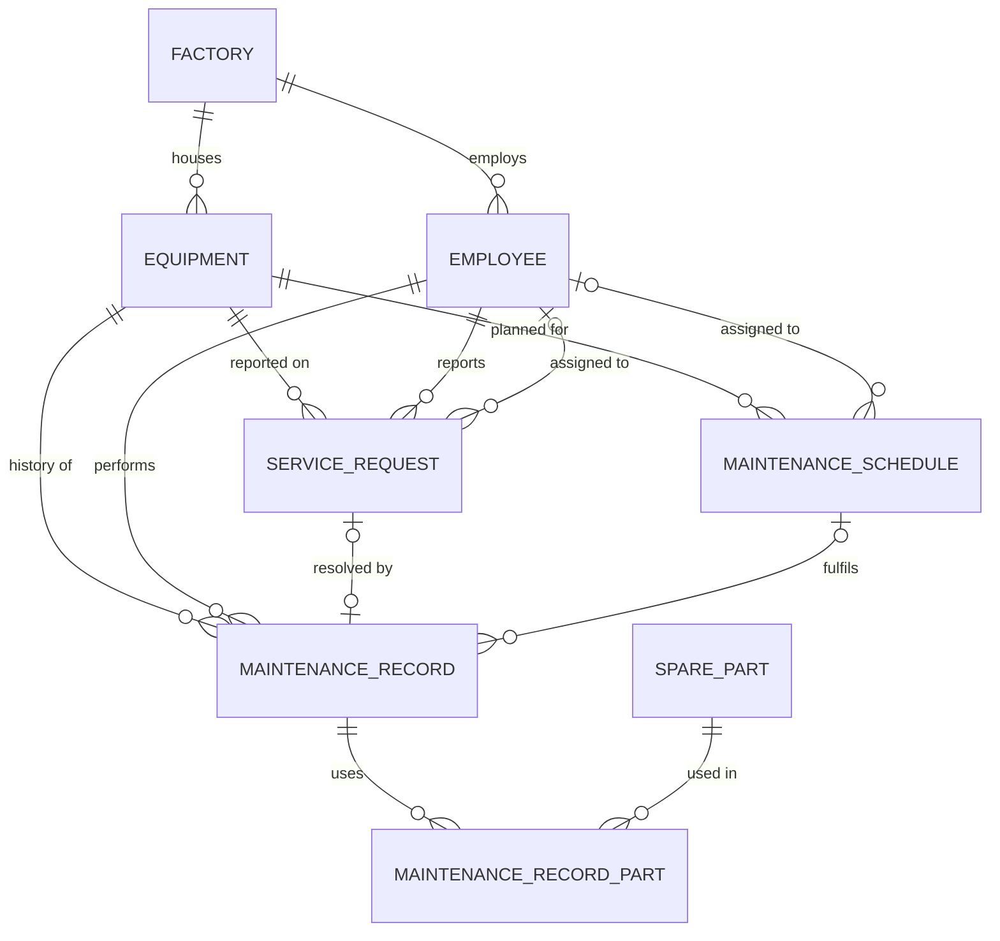
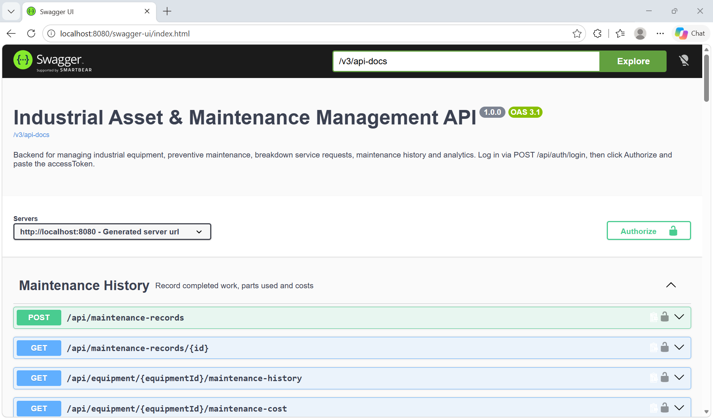

# Industrial Asset & Maintenance Management System

A Spring Boot REST API that helps an industrial organisation manage its machinery,
preventive maintenance, breakdown reports, technicians, spare parts and repair history.

> This is an independent educational project inspired by industrial maintenance workflows.
> It is not affiliated with any company, and all data used with it is synthetic.

## Features

- **Equipment management**: register, update, search by code or serial number, and retire machines (soft delete)
- **Employees and factories**: roles (Admin, Manager, Technician, Operator) assigned to factory locations
- **Preventive maintenance**: recurring schedules by calendar interval and, optionally, by operating hours ("every 500 hours or 6 months, whichever comes first"); overdue detection uses the machine's latest sensor reading
- **Breakdown workflow**: service requests move through `OPEN → ASSIGNED → IN_PROGRESS → (ON_HOLD) → COMPLETED / CANCELLED`, enforced as a state machine; machine status updates automatically
- **Maintenance history**: completed work, spare parts used (with price snapshots) and total cost per machine
- **Manager dashboard**: equipment availability, open requests, overdue tasks, total spend, most frequently failing machines and technician workload
- **Security**: BCrypt password hashing, JWT authentication and role-based access control
- **Consistent error handling**: structured JSON errors with correct HTTP status codes (400, 401, 403, 404, 409, 422, 500)
- **Sensor monitoring**: machines (or the included simulator) submit temperature, vibration, oil pressure and operating hours through a least-privilege `SENSOR` role
- **Automatic alerts**: configurable warning and critical thresholds raise alerts without duplicates, escalate warnings, and open a CRITICAL service request automatically
- **Equipment health score**: a 0–100 score per machine (GOOD / FAIR / AT_RISK) with an explanation of every deduction

## Tech stack

| Area | Technology |
|---|---|
| Language | Java 21 |
| Framework | Spring Boot 4 (Web MVC, Data JPA, Validation, Security) |
| Database | PostgreSQL |
| Authentication | Spring Security, OAuth2 Resource Server (JWT, HS256), BCrypt |
| API documentation | springdoc-openapi (Swagger UI) |
| Logging | SLF4J + Logback |
| Testing | JUnit 5, Mockito, Spring Boot Test, MockMvc |
| Build | Maven |
| Containers | Docker, Docker Compose |

## Architecture

The application uses a layered architecture:

```
Client (Postman / Swagger UI)
        │
        ▼
Controllers   ── REST endpoints, request/response DTOs, validation
        │
        ▼
Services      ── business rules, workflows, transactions
        │
        ▼
Repositories  ── Spring Data JPA
        │
        ▼
PostgreSQL
```

Cross-cutting concerns: a global exception handler, JWT security filter chain, structured logging and OpenAPI documentation.

## Data model



## Roles and permissions

| Action | Admin | Manager | Technician | Operator |
|---|:---:|:---:|:---:|:---:|
| View equipment, schedules, requests and history | ✅ | ✅ | ✅ | ✅ |
| Register or change equipment and spare parts | ✅ | | | |
| Manage employees and factories | ✅ | view | | |
| Report a breakdown | ✅ | ✅ | | ✅ |
| Assign or cancel requests, manage schedules | ✅ | ✅ | | |
| Start, hold, resume or complete repairs; record maintenance | | ✅ | ✅ | |
| View the dashboard | ✅ | ✅ | | |

## Getting started

### Configuration

The application reads secrets from environment variables. They are never stored in the code.

| Variable | Purpose |
|---|---|
| `DB_PASSWORD` | PostgreSQL password |
| `JWT_SECRET` | Key for signing tokens (at least 32 characters, random) |
| `ADMIN_PASSWORD` | Password for the initial `admin@maintenance.local` account, created on first start |

### Option A: Docker Compose (recommended)

Requires Docker Desktop.

```bash
git clone https://github.com/praveena-anand/industrial-asset-maintenance-system.git
cd industrial-asset-maintenance-system
cp .env.example .env        # then edit .env and set your own values
docker compose up --build -d
```

The API is then available at http://localhost:8080. Stop it with `docker compose down`.

### Option B: Run locally

Requires Java 21+, PostgreSQL and the environment variables above.

1. Create a database named `maintenance_db`
2. Run `./mvnw spring-boot:run` (or `mvnw.cmd spring-boot:run` on Windows), or run `MaintenanceApplication` from your IDE

## Using the API

Interactive documentation: **http://localhost:8080/swagger-ui.html**

1. Call `POST /api/auth/login` with an email and password
2. Copy the `accessToken` from the response
3. Click **Authorize** in Swagger UI and paste the token
4. Protected endpoints can now be called; access depends on the user's role

Example with curl:

```bash
curl -X POST http://localhost:8080/api/auth/login \
  -H "Content-Type: application/json" \
  -d '{"email":"admin@maintenance.local","password":"<your ADMIN_PASSWORD>"}'

curl http://localhost:8080/api/equipment \
  -H "Authorization: Bearer <accessToken>"
```

## Sensor simulator

`simulator/sensor_simulator.py` (Python 3.9+, standard library only) acts as a machine's sensor gateway.

1. As an admin, create an employee with role `SENSOR` and set its password
2. Set the credentials and start the simulator:

```bash
export SENSOR_EMAIL=sensor-eq1001@maintenance.local      # PowerShell: $env:SENSOR_EMAIL = "..."
export SENSOR_PASSWORD=<sensor password>
python simulator/sensor_simulator.py --equipment-id 1 --mode overheating --interval 2
```

Modes: `normal`, `overheating` (temperature rises steadily) and `wear` (vibration rises steadily).
Use `--start-hours` to begin above the machine's last recorded operating hours.

Alert thresholds are configured in `application.properties` under `app.thresholds.*`.


### Main endpoints

| Area | Endpoints |
|---|---|
| Authentication | `POST /api/auth/login` |
| Equipment | `/api/equipment`, `/api/equipment/{id}`, `/api/equipment/code/{code}`, `/api/equipment/serial/{serial}` |
| History and cost | `/api/equipment/{id}/maintenance-history`, `/api/equipment/{id}/maintenance-cost` |
| Employees and factories | `/api/employees`, `/api/factories` |
| Schedules | `/api/maintenance-schedules`, `/overdue`, `/upcoming?days=30`, `/{id}/assign`, `/{id}/complete` |
| Service requests | `/api/service-requests`, `/{id}/assign`, `/{id}/start`, `/{id}/hold`, `/{id}/resume`, `/{id}/complete`, `/{id}/cancel` |
| Maintenance records | `/api/maintenance-records`, `/api/spare-parts` |
| Dashboard | `GET /api/dashboard` |
| Health | `GET /api/health` (public) |
| Sensor readings | `POST /api/equipment/{id}/readings` (SENSOR), `GET /api/equipment/{id}/readings`, `/readings/latest` |
| Alerts | `GET /api/alerts`, `GET /api/equipment/{id}/alerts`, `PATCH /api/alerts/{id}/acknowledge`, `/resolve` |
| Health | `GET /api/equipment/health`, `GET /api/equipment/{id}/health` |

### Error format

All errors use the same structure:

```json
{
  "timestamp": "2026-11-20T10:30:00",
  "status": 409,
  "error": "Conflict",
  "message": "Equipment code EQ1001 already exists",
  "path": "/api/equipment"
}
```

## Running the tests

Integration tests use a separate PostgreSQL database, `maintenance_test_db`, which must exist.

```bash
./mvnw test
```

The test suite includes:
- **Unit tests** (JUnit 5 + Mockito) for business rules and the service request state machine
- **MockMvc tests** for HTTP status codes, validation, error responses and role-based access
- **Integration tests** for full workflows against a real database, including a real login with JWT

## Project structure

```
src/main/java/com/industrial/maintenance/
├── config/        security, JWT, OpenAPI, initial admin account
├── controller/    REST endpoints
├── dto/           request and response objects
├── entity/        JPA entities and enums
├── exception/     custom exceptions and global error handler
├── repository/    Spring Data JPA repositories
└── service/       business logic
```

## Screenshots



## Possible extensions

- Database migrations with Flyway
- Pagination for list endpoints
- Cloud deployment